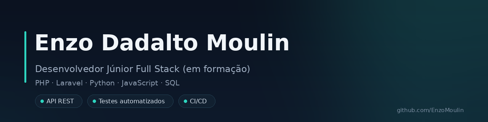

**Buscando a primeira vaga CLT júnior** — remota, híbrida ou presencial em Vitória/ES — **e freelas** de back-end ou full stack.

Vitória, ES · [LinkedIn](https://www.linkedin.com/in/enzodadaltomoulin) · [E-mail](mailto:dadaltoenzo@gmail.com)

Dois anos de estágio de TI no TJES, onde concebi e desenvolvi o MVP do diretório institucional de
contatos: **1.800+ contatos de 69 comarcas**. O produto evoluiu para três gerações — Apps Script,
Python e Laravel — e é o que este perfil reúne.

## Diretório de Contatos — três gerações

| Geração | Stack | O que entrega | Estado |
|:--|:--|:--|:--|
| **[v3](https://github.com/EnzoMoulin/diretorio-contatos-v3)** | Laravel 13 · Blade · Postgres | listagens por canal com filtro por unidade/setor, folha A4, 444 ramais e API REST no contrato da v2 | em desenvolvimento |
| **[v2](https://github.com/EnzoMoulin/diretorio-contatos-v2)** | Python stdlib · SQLite | API REST, OAuth Google, 94 testes e fumaça Playwright no CI | pronto; demo a caminho |
| **v1** | Apps Script · Sheets | MVP original, espelho sanitizado e congelado | privado (código institucional) |

**v3** é a versão atual: Laravel 13 + Blade no mesmo processo que serve HTML e JSON, Postgres no
Neon e CI com Pest, Pint, Larastan, acessibilidade WCAG AA e comparador de contrato. Próximos
passos: fechar o comparador de `contatos` e o mapa por CEP.

**v2** é a reescrita em Python só-stdlib: 94 testes, login Google, modo somente-leitura e duas
pernas de CI. O demo público sai no Render free; o repositório já tem a cartilha de deploy.

**v1** é o MVP que deu origem a tudo, feito durante o estágio. O repositório é privado por ser
código institucional; o estudo de caso está no
[README da v2](https://github.com/EnzoMoulin/diretorio-contatos-v2#estudo-de-caso-v1--v2--v3).

## Stack

  
  
  
  
  
  
  
  

Testes automatizados em todo PR, acessibilidade WCAG AA e comparação de contrato entre versões.
Nenhum dado real nos repositórios públicos: os demos usam base fictícia e mascarada.

---

**Contato** · [LinkedIn](https://www.linkedin.com/in/enzodadaltomoulin) ·
[dadaltoenzo@gmail.com](mailto:dadaltoenzo@gmail.com) · [GitHub](https://github.com/EnzoMoulin)
