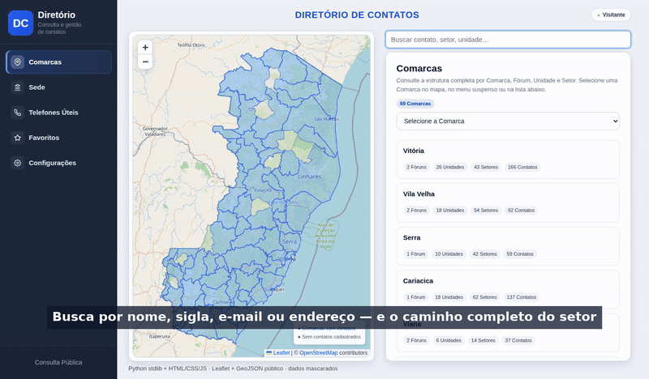

**Buscando a primeira vaga júnior — CLT ou PJ —** em back-end, front-end ou full stack. 
Remota, híbrida ou presencial na Grande Vitória/ES. Também aberto a **freelas**.

Vitória, ES · [LinkedIn](https://www.linkedin.com/in/enzodadaltomoulin) · [E-mail](mailto:dadaltoenzo@gmail.com)

[**Roadmap**](https://github.com/users/EnzoMoulin/projects/3) · o que está aberto no v2 e no v3

Dois anos de estágio no TJES, os últimos cinco meses no Laboratório de Inovação e IA, onde concebi e
desenvolvi o MVP do diretório institucional de contatos: **1.800+ contatos de 69 comarcas**. O produto
evoluiu em fases — Google Apps Script, Python e Laravel — e é o eixo deste perfil.

## Diretório de Contatos

Um produto só, em fases de fundação técnica — não três projetos. Os repositórios ficam separados
porque a stack muda; cada fase anterior continua pública como evidência.

| Fase | Stack | O que entrega | Estado |
|:--|:--|:--|:--|
| **[v3](https://github.com/EnzoMoulin/diretorio-contatos-v3)** | Laravel 13 · Blade · Postgres | listagens por canal com filtro por unidade/setor, folha A4, 444 ramais e APIs REST no contrato da v2 | em desenvolvimento |
| **[v2](https://github.com/EnzoMoulin/diretorio-contatos-v2)** | Python stdlib · SQLite | APIs REST, OAuth Google, 94 testes e fumaça Playwright no CI | pronto; demo a caminho |
| **v1** | Apps Script · Sheets | MVP original, espelho sanitizado e congelado | privado (código institucional) |

  
   
  Fase 2 (v2), Python + SQLite: busca, mapa e ficha do contato.

**v3** é a versão atual: Laravel 13 + Blade no mesmo processo que serve HTML e JSON, Postgres no
Neon e CI com Pest, Pint, Larastan, testes de acessibilidade (axe-core, critérios AA) e comparador de contrato. Próximos
passos: fechar o comparador de `contatos` e o mapa por CEP.

**v2** é a reescrita em Python só-stdlib: 94 testes, login Google, modo somente-leitura e duas
pernas de CI. O demo público sai no Render free; o repositório já tem a cartilha de deploy.

**v1** é o MVP que deu origem a tudo, feito durante o estágio. O repositório é privado por ser
código institucional; o estudo de caso está no
[README da v2](https://github.com/EnzoMoulin/diretorio-contatos-v2#estudo-de-caso-v1--v2--v3).

## Será que é golpe?

**Segundo produto** — quiz educativo sobre golpes digitais em HTML, CSS e JavaScript sem dependências,
[publicado no GitHub Pages](https://enzomoulin.github.io/sera-golpe/)
([código](https://github.com/EnzoMoulin/sera-golpe)). Atividade extensionista do curso de ADS (Gran),
pensada para aplicação remota e assíncrona.

## Stack

  
  
  
  
  
  
  
  

No diretório de contatos: testes em todo PR, acessibilidade medida com axe-core (critérios AA) e comparação de contrato entre versões.
Nenhum dado real nos repositórios públicos: os demos usam base fictícia e mascarada.

---

**Contato** · [LinkedIn](https://www.linkedin.com/in/enzodadaltomoulin) ·
[dadaltoenzo@gmail.com](mailto:dadaltoenzo@gmail.com) · [GitHub](https://github.com/EnzoMoulin)
